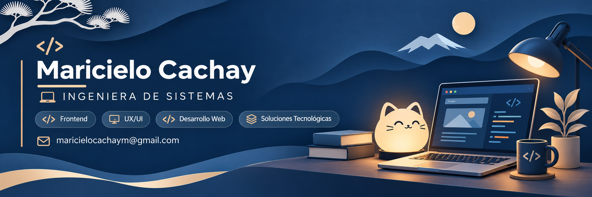
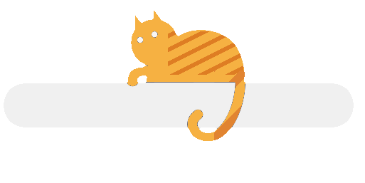

<!-- ==================== HEADER ==================== -->

  

  <h2>Frontend Developer</h2>
  
<em>Building interfaces. Connecting ideas. Creating meaningful web experiences.</em>

  

    <a href="https://linkedin.com/in/maricielocachay">LinkedIn</a>
    &nbsp;·&nbsp;
    <a href="mailto:maricielocachay@gmail.com">Email</a>
    &nbsp;·&nbsp;
    Cajamarca, Peru
  

---

## About Me

<table style="border: none; border-collapse: collapse;">
  <tr style="border: none;">
    <td width="72%" valign="middle" style="border: none;">
      

        I'm Maricielo, a Systems Engineering student at the
        <strong>National University of Cajamarca</strong>,
        with a professional focus on <strong>Frontend Development</strong>.
      

      

        I'm interested in building web interfaces that combine functionality,
        usability and visual consistency. Through academic and collaborative
        projects, I've gained experience in interface development,
        feature implementation, API integration and usability testing.
      

      

        I enjoy learning through practice, solving problems and exploring
        how design and technology come together to create meaningful
        digital experiences.
      

    </td>
    <td width="28%" align="center" valign="middle" style="border: none;">
      
       
    </td>
  </tr>
</table>

---

## Tech Stack

**Frontend**

  
  
  
  
  
  

**Tools & Databases**

  
  
  
  
  
  

**Currently Learning**

  
  

---

## Featured Projects

Selected academic and collaborative projects showcasing my experience in software development and interface design.

### 01. AeroSense — NASA Space Apps Challenge 2025

**Air Quality Monitoring & Forecasting**

Collaborative project developed with the **SOTHARA team** for the NASA Space Apps Challenge 2025.

- Participated in frontend development using React and TypeScript.
- Contributed to dashboard and air-quality interface improvements.
- Collaborated through Git branches and Pull Requests.

`React` `TypeScript` `APIs`

[View repository →](https://github.com/roimerbautista/sothara)

---

### 02. Commercial CRM System

**Contact Management & Information Visualization**

Collaborative project focused on the management and consultation of commercial contacts.

- Developed contact listing and search functionalities.
- Implemented contact detail views and navigation between modules.
- Participated in interface development and information presentation.

`HTML` `CSS` `Bootstrap` `MySQL`

---

### 03. Shoe Store Inventory Application

**Inventory Management & User Interface Design**

Academic project focused on product and stock management.

- Designed user interfaces, screen structures and navigation flows.
- Participated in frontend and backend development of inventory functionalities.
- Used Figma for interface design and Android Studio in the development environment.

`Figma` `Android Studio`

---

## Additional Experience

**Quality Assurance — JobMatch**

- Performed usability tests on company and applicant interfaces.
- Identified and documented visual issues, responsiveness problems and hidden content.
- Evaluated interface presentation and navigation using checklists.

**Business Intelligence & Data Analysis**

- Developed academic dashboards using Excel and Power BI.
- Prepared and transformed data using Power Query.
- Created visualizations and indicators for commercial and inventory analysis.

---

## Beyond the Code

I'm interested in continuous learning, problem-solving and exploring the relationship between design and technology.

Outside development, I enjoy **painting landscapes and nature, drawing and creating visual compositions**.

---

## Let's Connect

I'm open to connecting with developers, sharing knowledge and exploring opportunities to grow in frontend development.

  

    
    
  

  
  Designed with purpose · Continuously learning and building.

